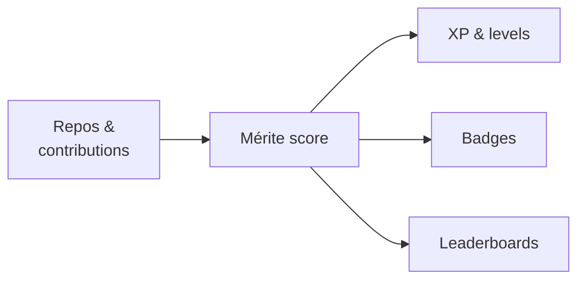

<div align="center">

# githubCrawler

**Developer ranking, gamified. Earn your place through the code you ship.**


</div>

---

## The idea: *le mérite*

Titles and follower counts are easy to fake. Code isn't.

githubCrawler turns a developer's public GitHub activity (repositories, pull requests, reviews, consistency) into **XP, levels, badges and leaderboards**. Your rank is earned, explainable, and open for anyone to verify.



## What it will do

- **XP**: earned from merged PRs, reviews, maintained repos and real usage of your projects
- **Levels & tiers**: climb from newcomer to legend as your score grows
- **Badges**: achievements like *First merged PR*, *Polyglot*, *30-day streak*, *Maintainer*
- **Leaderboards**: global, by language, by country, by domain
- **Seasons**: periodic rankings so newcomers can compete too
- **Profile cards**: an embeddable rank card for your GitHub profile
- **Fair play**: forks, empty repos, commit spam and self-stars don't count

## Today

The crawler lists a user's public repos and extracts a short description from each README.

```bash
git clone https://github.com/rayenamer/githubCrawler.git && cd githubCrawler
echo "GITHUB_TOKEN=github_pat_your_token_here" > .env
./start_all.sh octocat
```

> A GitHub token is optional, but without one you're limited to 60 requests/hour.

## Roadmap

- [x] Crawl repos and README descriptions
- [ ] Enrich: languages, stars, topics, activity
- [ ] Contributions: PRs, reviews, issues on other people's repos
- [ ] Mérite score: transparent, every point traceable
- [ ] Gamification: XP, levels, badges
- [ ] Leaderboards, seasons and profile cards

## Contributing

The hardest question is **how to measure merit fairly**. Ideas are welcome, so open an issue.
